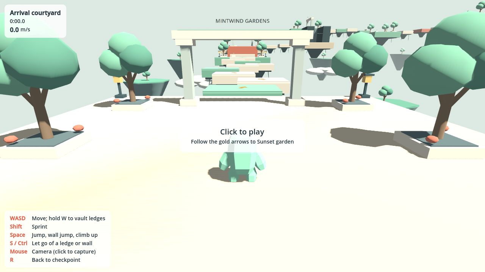
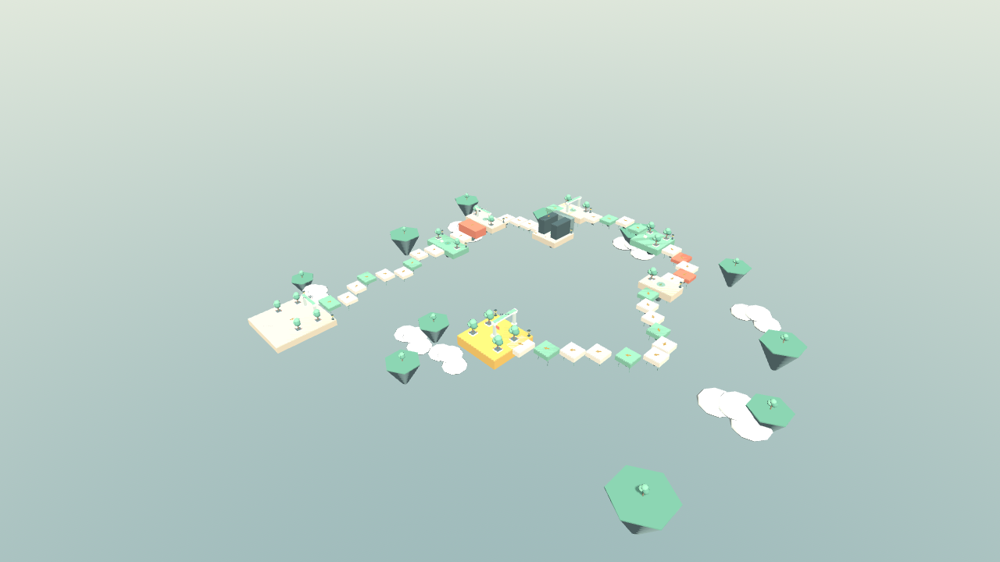

# Mint Blob Parkour · Mintwind Gardens

A native, offline **Godot 4.5.1** parkour game built from the uploaded HTML game and its original animated blob character. No browser wrapper, plug-ins, packages, or network connection is needed to play.

## Run

1. Install **Godot 4.5.1 Standard** (GDScript; .NET is unnecessary).
2. Extract the project, then import its `project.godot` in Godot.
3. Let the character model import and press **F5**. Click in the game to capture the mouse; **Esc** releases it.

The project uses the Compatibility renderer, a resizable 1280 × 720 window, and 120 Hz physics. Its main scene is `scenes/main.tscn`. Let 4.5.1 generate its own `.godot` cache rather than reusing a newer editor's cache.

## Calmer movement and grounded climbing

Horizontal movement is **60% of the previous version**: walking is 3.12 m/s and sprinting builds from 5.7 to 7.8 m/s. Acceleration, air steering, wall pushes, wall-jump speed limits, vault boosts, camera feedback, and sprint dust are tuned consistently. Jump height remains available for the redesigned obstacles.

Ledge catches preserve the position you actually reach. Both hands grip the real platform lip, the feet brace against its wall, and the body pulls up before crossing onto the platform. The animation's extra jump displacement has been removed, so it no longer adds a second jump above the physical character.

Hold W through a grab, or follow up with W, ↑ or Space within 0.22 seconds, for a supported 0.48-second pull-over. It preserves approach momentum and adds a modest 0.9 m/s, capped at 8.7 m/s. When half the body is already above a lip, a 0.32-second step-over helps complete the jump. Waiting at a ledge retains the normal 0.95-second climb. All climbs check headroom and standing clearance; there is no upward launch on exit.

## A larger garden course

**45 route platforms, 47 collision pieces, eight checkpoints, and roughly 250 meters of winding route.** The gaps fit the lower movement speed. Follow the gold arrows through:

1. Arrival courtyard
2. Mint garden
3. Terrace ruins
4. Wall-jump courtyard
5. Sky gate
6. Cloud orchard
7. Wind bridge
8. Sunset garden and the finish flag

Trees, planted courtyards, stone arches, lanterns, hanging roots, distant floating islands, clouds and a soft sky give each part of the route a place in the garden. Checkpoint names and numbered stones help you keep track of progress.

The overview uses a distant camera with fog disabled for visibility; gameplay keeps its normal distance fog.

## Controls

| Key | Action |
| --- | --- |
| W / A / S / D | Move relative to the camera |
| Shift | Sprint |
| Space | Jump, wall jump, or climb a grabbed ledge |
| Release Space early | Shorten a normal jump |
| W / ↑ / Space just after grabbing | Quick pull-over; holding W through the grab also works |
| S / Ctrl | Let go of a wall or ledge |
| Mouse after clicking | Orbit the camera |
| Esc | Release the mouse |
| R | Return to the current checkpoint, keeping elapsed time |
| Enter after finishing | Start a new run |

The timer starts with WASD or Space. Alternate walls and press Space again at each contact to climb the shaft. Reach the gold finish platform to complete the course. Progress is not saved between runs.

## Edit and export

- `scripts/player.gd`: movement constants, axis-separated collision, jumps and ledge mechanics.
- `scripts/blob_visual.gd`: original GLB clip blending, planted-hand contact and foot poses.
- `scripts/course.gd`: platform coordinates, checkpoints, route metadata and procedural garden scenery.
- `scripts/game.gd`: input, timer, checkpoint progression and restart.
- `scripts/follow_camera.gd`, `dust.gd`, `game_hud.gd`: camera, effects and native UI.
- `assets/mint_blob.glb`: the original character extracted from the uploaded HTML.

The map is generated when the scene starts; edit `course.gd` to change it. To export an executable, install the matching **4.5.1 export templates** and use **Project → Export** for your platform.

## Validation

Tested on **Godot 4.5.1.stable.official.f62fdbde1**. All **534 checks pass**, including a controls-only run through the entire expanded course, every checkpoint, actual hand-tip contact, and the revised movement and vault mechanics. See `TESTING.md` for commands and coverage.
