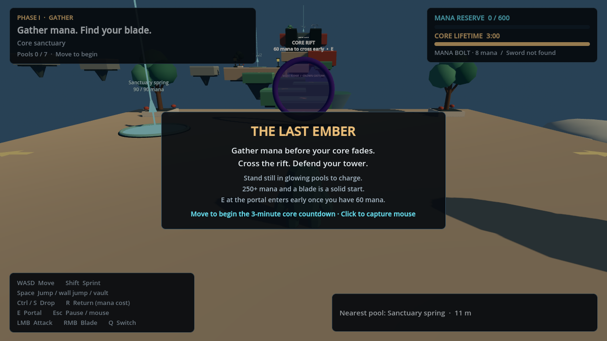
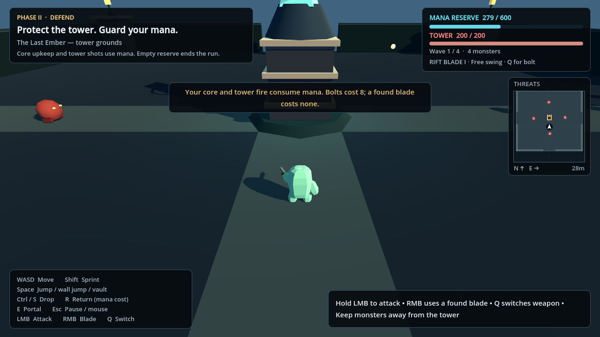

# Mint Blob: The Last Ember · Godot 4.5.1

A playable two-phase parkour and tower-defense prototype. Explore a branching sky-island map, collect finite mana and a sword before your core fades, cross the rift, then protect the Heartkeep from monsters using the reserve you actually gathered.

## Run

1. Install **Godot 4.5.1 Standard** (GDScript; .NET is unnecessary).
2. Extract the project and import `project.godot`.
3. Wait for asset import and press **F5**. Click or move to begin.

Everything runs locally. No browser wrapper, plug-ins, external assets, packages, or online service is required. The project uses the Compatibility renderer and 120 Hz physics. Let 4.5.1 generate its own `.godot` cache.

## Phase I: gather before the core fades

Your core has **180 seconds** of exploration lifetime. The timer waits while you read the intro, then starts when you click or move.

Seven mana pools lie across four branches of a roughly **151 × 157 meter** map. Routes include narrow beams, longer gaps, vertical ledges, a wall-jump shaft, and an optional shortcut between branches. Cyan beacons, signs and the field map help you find the pools. **Stand still inside a pool while grounded** to draw 24 mana per second. Each pool has a finite reserve and visibly empties; a full core does not waste the pool's remaining mana.

- Mana capacity: **600**; the map contains **810** total.
- A moderate west-route detour holds the **Garden blade**.
- The harder Crown route holds the stronger **Crown greatsword**.
- Attuned anchors provide recovery points. Falling or pressing R costs **15 mana and eight core seconds**; it does not refill drained pools.

Return to the violet sanctuary portal and press **E** to enter early with at least 60 mana. **250+ mana and a sword is a sensible first target.** When the core lifetime expires, a rift opens automatically wherever you are. A brief transfer carries your collected mana and sword into the second area. Reaching the rift with no mana ends the run.

## Phase II: protect the Heartkeep

Defend a **200-health tower** through four escalating waves: **4, 6, 8 and 10 monsters**. Crawlers advance quickly; horned brutes have more health and deal heavier tower damage. A short preparation period and breaks between waves give you time to reposition. The threat radar shows incoming enemies around the tower.

Your mana reserve is the shared resource for the whole defense:

- Core upkeep drains **0.6 mana per second**.
- The tower automatically fires at nearby monsters, spending **two mana per bolt**.
- Your mana bolts cost **eight mana**, deal 24 damage, and can be fired by holding the attack button.
- A collected sword attacks for **no mana**. The Garden blade deals 30 damage; the Crown greatsword deals 44. Aim and approach from the correct side of the monster.
- Monsters that reach you can strike your core and drain mana. Returning to the tower with R costs **20 mana**.

**Zero mana or a destroyed tower loses the run.** Clear all four waves with both intact to win. The result card explains the outcome; press Enter for a fresh expedition. Resources, pickups, enemies, weapons and timers reset together.

## Controls

| Input | Action |
| --- | --- |
| W / A / S / D | Move relative to the camera |
| Shift | Sprint |
| Space | Jump, wall jump, or climb a ledge |
| Hold W through a grab | Supported quick vault |
| S / Ctrl | Let go of a wall or ledge |
| Mouse after clicking | Orbit the camera / face attacks |
| E near the sanctuary portal | Enter the defense early with enough mana |
| Left mouse | Attack with the selected weapon; hold to repeat |
| Right mouse | Swing a collected sword |
| Q | Switch between the mana bolt and collected sword |
| F / V | Keyboard alternatives for bolt / sword attacks |
| R | Return to your anchor or tower, paying its resource penalty |
| Esc | Pause and release the mouse; Esc or click resumes |
| Enter on a result or while paused | Start a new expedition |

The game also pauses when the window loses focus, including during portal transfer. Walking and sprinting retain the calmer **3.12 / 5.7–7.8 m/s** tuning. Hands remain planted during catches and pull-ups; the attack animation does not alter physical jump height.

## Development and practice

The original garden course remains available as **`scenes/practice.tscn`**. Open it and press F6 for unrestricted checkpoint parkour. F5 always starts the new expedition.

- `scripts/game.gd`: connects input, exploration, portal transfer, defense and results.
- `scripts/run_state.gd`: core lifetime, shared mana, weapon ownership, win/loss rules.
- `scripts/expedition_map.gd`: branching map, finite pools, pickups and anchors.
- `scripts/defense_arena.gd`: monsters, waves, tower, projectiles and melee damage.
- `scripts/expedition_hud.gd` / `expedition_radar.gd`: phase instructions, resource bars, context and tactical map.
- `scripts/player.gd` / `blob_visual.gd`: parkour physics, original character clips, hand contacts, held swords and attack poses.
- `scripts/course.gd`: shared geometry and cinematic dusk lighting; also the practice course.

The main maps are built procedurally from authored coordinates at startup. Tune resources in `run_state.gd`, pool locations in `expedition_map.gd`, and wave/combat values in `defense_arena.gd`. To make an executable, install the matching **4.5.1 export templates** and use **Project → Export**.

## Verification

Tested using **Godot 4.5.1.stable.official.f62fdbde1**: **1,655 checks passed** across the movement, resources, UI, combat and connected-run suites. The complete main-scene playtest starts with an empty core, uses actual movement inputs to gather **310 mana and a blade**, returns to the portal in **93.89 seconds**, transfers normally, and defeats all **28 monsters**. It ends with **167.5 mana and 152 tower health**, without test-only teleports, resource edits, enemy edits, or damage helpers.

All seven pools and both swords also have independent controls-only reachability coverage. See `TESTING.md` for repeatable checks and `docs/ROGUELITE_IDEAS.md` for future expansion ideas. This is a playable prototype with authored maps and four defense waves; persistent unlocks and randomized rooms are future work.
